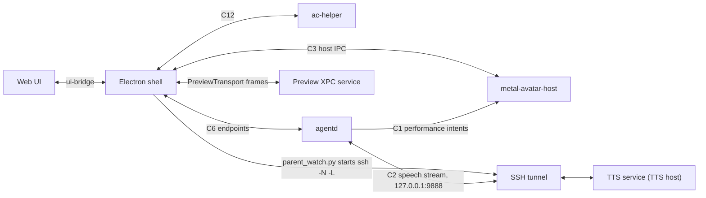

# Repository and runtime architecture

[简体中文](overview.md)

**Agentic Complex** is an experimental desktop character and personal agent app primarily targeting Apple Silicon macOS (with Windows x64 support in active development). The Electron shell manages windows, the tray, and child processes; the control panel and desktop panels are its web windows. A native helper provides platform services such as system permissions, screen reading, capture, and push-to-talk. `agentd` handles character conversations, tasks, memory, and tool calls. The Metal host on macOS (or the work-in-progress D3D11 host on Windows) loads rendering and animation assets from the character library. Voice comes from external TTS; without one, replies are shown as text only.

See the [product guide](../product.en.md) for features and interaction design.

## Top-level directories

| Directory | Contents |
|---|---|
| `app/` | `electron/` is the Electron shell: windows, the tray, child process supervision, the agentd client, the C3 link, and the web bridge; see [shell](shell.en.md). `helpers/mac` is the platform helper `ac-helper`, written in Swift (protocol C12), and `helpers/windows` its Windows counterpart `ac-helper.exe`. In `Resources/`, `agentd_launcher.py` ships with agentd and `parent_watch.py` with host. `packaging/` contains `release.json`. The build entry point is `build_app.sh` and the host gate is `Tests/gate.sh`. |
| `web/` | The React and TypeScript UI that runs in the Electron shell's windows, bundled into `web-ui`; see [web UI](web-ui.en.md). |
| `agent/` | `agentd/` contains the Python character agent, `browser/` the browser extension and native host, and `computer-control/` the computer-use MCP bridge guide and acceptance tooling. See [agentd](agentd.en.md). |
| Renderer (not in the public repository) | The macOS Metal host `metal-avatar-host`, its XPC preview service and the Windows D3D11 renderer `efw.exe`. Their source is a private component that ships only in releases. The shell's preview client is `app/electron/native/mac/preview.m`; the interfaces to the renderer are C1, C2 and C3. |
| `characters/` | Character package tools: import (`agentic_complex_build/`, entry point `build.py`), native package packing (`packaging/`), the text-only sample character `sample-character/` and the sample library `sample-library/`. External tools generate character packages in the format defined by `protocol/character-library/CONTRACT.md`. See [character tools and motion generation](characters.en.md). |
| `motion/` | The motion generation service, an HTTP service that generates a motion from a text description. See [Character package tools and motion generation](characters.en.md#motion-generation-service). |
| `voice/` | TTS service code in `tts-service/`. The service runs on a TTS host. See [Speech synthesis service](voice.en.md) and [Deploying the voice service](../guides/tts-deploy.en.md). |
| `protocol/` | Interfaces between components: the process protocols C1, C2, C3, C6, C8, C9, and C12, the shared file C10, the component manifest C11, `ui-bridge` (app host ↔ web UI), and the file formats of the character library and scene packs. Each has a contract text, validators and fixtures. See the [protocol index](../../protocol/README.md) for the list. |
| `tools/` | `dev/` provides the dev console, `qa/` gates and path checks, `release/` releases, packaging, development deployment, and gate receipts, `platform/` GPU locking and signing, and `acp/` the ACP agent installer. See [development and releases](../development.en.md) for commands. |
| `docs/` | Current architecture, development, and design documentation. |
| `private` | Local content, not in the public repository. |

Git excludes these generated or machine-local directories.

| Directory | Contents |
|---|---|
| `.local/inputs/` | Local inputs used by external tools to generate character packages. Override the location with `AAC_INPUTS`. |
| `.local/output/` | Generated character libraries, candidate packages, and runtime outputs. The private profile's `character_catalog` can point here. |
| `.local/cache/` | Temporary gate files, GPU locks from `tools/platform/gpu-lock.sh`, and `personal-agent-runtime/` prepared for release builds by `tools/release/release.py`. |
| `.local/dev-runtime/` | The web UI and agentd code deployed to the installed app by `tools/release/dev_deploy.py`. `current` points to the active deployment. |
| `.local/pi-runtime/` | Node dependencies for the Pi SDK. In a source checkout, `agent/agentd/character_agent/harness/pi_config.py` resolves them. |
| `app/build/` | Release output under `releases/` as configured by `output_root` in `release.json`. |
| `app/helpers/mac/.build/` | SwiftPM build directories. |
| `app/electron/node_modules/`, `app/electron/dist/` | The Electron shell's dependencies and build output. |
| `web/node_modules/`, `dist/`, `test-results/`, `playwright-report/`, `.shots/` | Web dependencies, builds, and test artifacts. |
| `agent/.venv/` | The Python environment that supplies the interpreter and dependencies for release builds. |

## Runtime processes

- The web UI calls the main process's operations through `window.agenticComplex`, installed by the preload. Web UI requests to agentd use `agentd.request`, gated by `protocol/ui-bridge/routes.json`.
- The Electron shell starts agentd through `agentd_launcher.py`. `metal-avatar-host` and the preview XPC service use the same executable.
- External TTS runs outside the app. The Electron shell uses `parent_watch.py` to start `ssh -N -L 127.0.0.1:<port>:127.0.0.1:<port> <host>` based on `tts_url` (a new release install writes it empty, and replies are shown as text only; when config.json has no such key it is `http://127.0.0.1:9888`) and `tts_tunnel_host` (blank by default, which disables forwarding). The tunnel closes when the app exits. See `app/electron/src/main/tunnel/supervisor.ts`. With `tts_ensure_script` set, agentd can run that script over SSH on the same host to start TTS on demand. The script setting is blank by default.

The [protocol index](../../protocol/README.md) links to the contracts in `protocol/`.

The agentd entry point, `agent/agentd/server.py`, leads to three layers. `daemon/` supplies `AgentdServer` and its startup sequence, and `api/` supplies the HTTP `Handler`, which checks tokens and dispatches requests using `route_registry.py`. The domain packages are `sessions/`, `observation/`, `personal/`, `character/`, `voice/`, `models/`, `traces/`, `tool_gateway/`, `brain/`, and `character_agent/`. The `infra/` layer handles SQLite storage, token files, and state paths. See the [agentd code layout](agentd.en.md#code-layout) for details on each package and the files kept at the root.

See the [tool gateway](tool-gateway.en.md) for authorization by tool path, release of desktop access, the effect ledger, and tool registration.

## Release builds

`bash app/build_app.sh` invokes `package_release.sh`, then `tools/release/release.py`, `build_components.py`, and `package_app.py`. The default `--layout portable` bundles every component in `Agentic Complex.app`. With `--layout split`, the app bundles host, renderer, and web-ui, with the other components in `components/` beside it. See [release components and installation](../components.en.md) for the component list, layout comparison, installation, and missing-component behavior. A checkout without the renderer source (`private/renderer`) builds an app with no renderer component and no preview service; characters then show as text only.

| Location | Contents |
|---|---|
| `Contents/MacOS/` | `AgenticComplex` (host component, the Electron main executable), `ac-helper` (host component, the platform helper) and `AgenticComplexMetalAvatar` (renderer component, built as `metal-avatar-host`). |
| `Contents/XPCServices/<id>.preview.xpc` | `AgenticComplexMetalPreview` (renderer component, using the same host executable). |
| `Contents/Frameworks/`, `Contents/Resources/app/` (the shell's `package.json` and `dist/`), `parent_watch.py`, `AppIcon.icns` | Host component. The icon is present on builds that include UI art. |
| `Contents/Resources/window-envelopes.json` | Renderer component. |
| `Contents/Resources/components/<ID>/` | `component.json` manifest, with a `payload/` directory for components other than host and renderer. Portable builds include all components here. Split builds include host, renderer, and web-ui here. |
| `Contents/Resources/composition.lock.json` | Composition lock in portable builds. Split builds write this lock in the support directory after importing components. |
| `Contents/Resources/distribution.json` | Distribution identity, layout, default character, character catalog SHA, and port. |

The work-in-progress Windows x64 portable build is assembled into an `Agentic Complex\` directory by `tools/release/package_windows.py`; see [release components · Windows portable directory](../components.en.md#windows-portable-directory).

The external TTS service is deployed separately.
