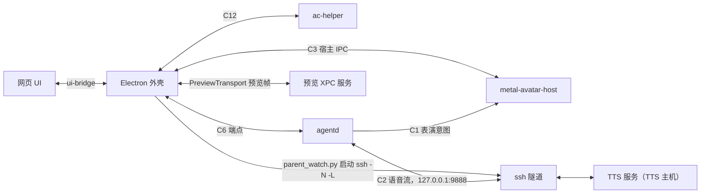

# 仓库与运行架构

[English](overview.en.md)

**Agentic Complex** 是一款以 Apple Silicon macOS 为主平台（Windows x64 端积极开发中）的实验性桌面角色与个人智能体应用。Electron 外壳管理窗口、托盘和子进程，控制面板与桌面浮窗是它的网页窗口；系统权限、读屏、截图、按住说话等平台能力由原生 helper 提供。`agentd` 负责角色会话、任务、记忆和工具调用。Metal 宿主（macOS）或 D3D11 宿主（Windows，开发中）从角色库加载可用的渲染和动作资源，语音由外部 TTS 合成，没有配置时只显示文字，不朗读。

功能和交互设计见[产品指南](../product.md)。

## 顶层目录

| 目录 | 内容 |
|---|---|
| `app/` | `electron/`（Electron 外壳：窗口、托盘、子进程监督、agentd 客户端、C3 连接、网页桥，见 [shell.md](shell.md)）、`helpers/mac`（Swift 写的平台 helper `ac-helper`，协议 C12）、`helpers/windows`（Windows 版 helper `ac-helper.exe`）；`Resources/`（`agentd_launcher.py` 进 agentd 组件，`parent_watch.py` 进 host 组件）；`packaging/`（发行配置 `release.json`）；发行入口 `build_app.sh`；门禁 `Tests/gate.sh` |
| `web/` | React + TypeScript 网页 UI，在 Electron 外壳的窗口里跑，构建进 web-ui 组件，见 [web-ui.md](web-ui.md) |
| `agent/` | `agentd/`（Python 角色 agent）、`browser/`（浏览器扩展与 native host）、`computer-control/`（computer use 的 MCP 桥说明与验收），见 [agentd](agentd.md) |
| 渲染器（不在公开仓库） | macOS Metal 宿主 `metal-avatar-host`、XPC 预览服务和 Windows D3D11 渲染器 `efw.exe`。源码是私有组件，只随发行版提供；外壳一端的预览客户端是 `app/electron/native/mac/preview.m`，和它的接口见 C1、C2、C3 |
| `characters/` | 角色包工具：导入（`agentic_complex_build/`，入口 `build.py`）、原生包打包（`packaging/`）、纯文字样例角色 `sample-character/` 和样例库 `sample-library/`；角色包由外部工具生成，格式见 `protocol/character-library/CONTRACT.md`，见[角色包工具与动作生成](characters.md) |
| `motion/` | 动作生成服务：按文字描述生成动作的 HTTP 服务，见[角色包工具与动作生成](characters.md#动作生成服务) |
| `voice/` | TTS 服务代码（`tts-service/`，部署在 TTS 主机上），见[语音合成服务](voice.md)和[部署语音服务](../guides/tts-deploy.md) |
| `protocol/` | 组件之间的接口：进程协议 C1、C2、C3、C6、C8、C9、C12，共享文件 C10，组件清单 C11，`ui-bridge`（应用宿主 ↔ 网页），以及角色库和场景包的文件格式；每项有正文、校验器和夹具，清单见 [协议索引](../../protocol/README.md) |
| `tools/` | `dev/`（开发面板）、`qa/`（门禁、路径检查）、`release/`（发行、打包、开发部署、门禁回执）、`platform/`（GPU 锁、签名）、`acp/`（ACP 智能体安装），命令见 [development.md](../development.md) |
| `docs/` | 本目录：现行架构、开发和设计文档 |
| `private` | 本机内容，不在公开仓库 |

以下目录不进 Git：

| 目录 | 内容 |
|---|---|
| `.local/inputs/` | 外部工具生成角色包所用的本地输入（位置可用 `AAC_INPUTS` 覆盖） |
| `.local/output/` | 本地生成的角色库、候选包和运行产物；本地发行配置的 `character_catalog` 可指向这里 |
| `.local/cache/` | 门禁临时目录、GPU 锁文件（`tools/platform/gpu-lock.sh`）、发行构建准备的 `personal-agent-runtime/`（`tools/release/release.py`） |
| `.local/dev-runtime/` | `tools/release/dev_deploy.py` 部署给已安装 app 的网页 UI 和 agentd，`current` 指向当前一份 |
| `.local/pi-runtime/` | Pi SDK 的 Node 依赖；源码检出里运行时由 `agent/agentd/character_agent/harness/pi_config.py` 找到它 |
| `app/build/` | 发行输出 `releases/`（`release.json` 的 `output_root`） |
| `app/helpers/mac/.build/` | SwiftPM 构建目录 |
| `app/electron/node_modules/`、`app/electron/dist/` | Electron 外壳的依赖和构建产物 |
| `web/node_modules/`、`dist/`、`test-results/`、`playwright-report/`、`.shots/` | 网页依赖、构建和测试产物 |
| `agent/.venv/` | agentd 的 Python 环境；发行构建从这里取解释器和依赖 |

## 运行时进程

- 网页 UI 经 preload 装的 `window.agenticComplex` 调主进程的 op，直接请求 agentd 路由只能走 `agentd.request`，按 `protocol/ui-bridge/routes.json` 放行。
- agentd 由 Electron 外壳经 `agentd_launcher.py` 启动；`metal-avatar-host` 和预览 XPC 服务是同一个宿主可执行文件。
- TTS 不在 app 里。Electron 外壳按配置 `tts_url`（新装的发行版写空值，只显示文字，不朗读；config.json 里没有这个键时取 `http://127.0.0.1:9888`）和 `tts_tunnel_host`（默认空，即不开隧道）用 `parent_watch.py` 拉起 `ssh -N -L 127.0.0.1:<端口>:127.0.0.1:<端口> <主机>`，应用退出时隧道一起退出（`app/electron/src/main/tunnel/supervisor.ts`）。再设了 `tts_ensure_script`（该主机上按需启动 TTS 的脚本，默认空）时，agentd 在 TTS 没起来时经 ssh 在这台主机上运行它。

协议全文在 `protocol/`，索引见 [protocol/README.md](../../protocol/README.md)。

agentd 的代码分三层：入口 `agent/agentd/server.py` → `daemon/`（`AgentdServer` 与启动顺序）和 `api/`（HTTP `Handler`，按 `route_registry.py` 的登记检查令牌并分派）→ 领域包（`sessions/`、`observation/`、`personal/`、`character/`、`voice/`、`models/`、`traces/`、`tool_gateway/`、`brain/`、`character_agent/`）→ `infra/`（SQLite 存储、令牌文件、状态路径）。各包和留在根目录的文件见 [agentd 代码结构](agentd.md#代码结构)。

agentd 每条工具路径由谁把关、桌面授权何时释放、效果账本和工具注册表见 [tool-gateway.md](tool-gateway.md)。

## 发行版

由 `bash app/build_app.sh` 构建（`package_release.sh` → `tools/release/release.py` → `build_components.py`、`package_app.py`）。默认 `--layout portable` 出一个装着全部组件的 `Agentic Complex.app`；`--layout split` 出只装 host、renderer、web-ui 的 `Agentic Complex.app`，其余组件放在 app 旁边的 `components/`。组件表、两种版本的比对、安装和缺组件时的表现见 [components.md](../components.md)。检出里没有渲染器源码（`private/renderer`）时，构建出的 app 没有 renderer 组件和预览服务，角色只显示文字。

| 位置 | 内容 |
|---|---|
| `Contents/MacOS/` | `AgenticComplex`（host 组件，Electron 主程序）、`ac-helper`（host 组件，平台 helper）、`AgenticComplexMetalAvatar`（renderer 组件，即 `metal-avatar-host`） |
| `Contents/XPCServices/<id>.preview.xpc` | 预览服务 `AgenticComplexMetalPreview`（renderer 组件，同一个宿主可执行文件） |
| `Contents/Frameworks/`、`Contents/Resources/app/`（外壳的 `package.json`、`dist/`）、`parent_watch.py`、`AppIcon.icns` | host 组件。包含 UI 美术的构建提供图标 |
| `Contents/Resources/window-envelopes.json` | renderer 组件 |
| `Contents/Resources/components/<ID>/` | 组件清单 `component.json`；host、renderer 以外的组件还有 `payload/`。portable 版有全部组件，拆分版只有 host、renderer、web-ui |
| `Contents/Resources/composition.lock.json` | 组合锁，只在 portable 版里；拆分版首次启动导入组件后写在支持目录 |
| `Contents/Resources/distribution.json` | 发行身份、layout、默认角色、角色库 SHA、端口 |

Windows x64 便携目录（WIP）由 `tools/release/package_windows.py`组装为 `Agentic Complex\` 目录，详情见[发行组件 · Windows 便携版](../components.md#windows-便携版)。

外部 TTS 服务单独部署。
